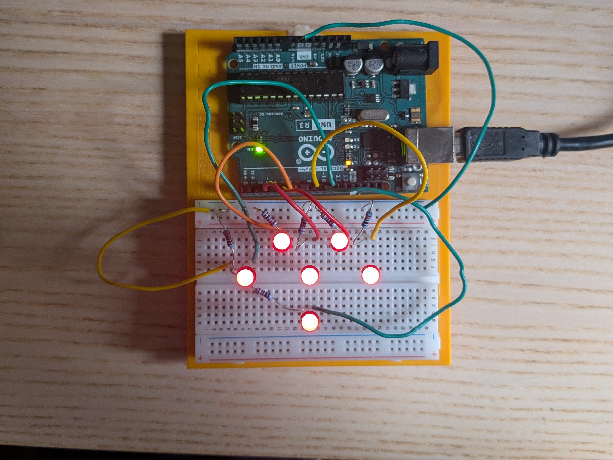

# Arduino-Heartbeat-Heart
A six-LED Arduino heartbeat display using PWM

# Arduino Heartbeat Heart

My first creative Arduino electronics project: a six-LED heart that produces a soft heartbeat-inspired lighting animation.

## What it does

The six LEDs light up together in a repeating sequence:
1. A short, dim flash
2. A brief pause
3. A smooth pulse that brightens quickly and fades out slowly
4. A rest before repeating

## Components

- Arduino Uno
- 6 LEDs
- 6 suitable current-limiting resistors
- Breadboard and jumper wires

## How it works

The LEDs are individually connected to PWM-capable pins 3, 5, 6, 9, 10 and 11. A `heart()` function uses `analogWrite()` to set the brightness of all six LEDs. Two `for` loops control the smooth pulse, with different delays for the brightening and fading stages.

## What I learned

- PWM and `analogWrite()`
- Using functions and parameters
- `for` loops and timing
- Building and troubleshooting a multi-LED circuit

Explore servo motors and build a miniature moving mechanism.
